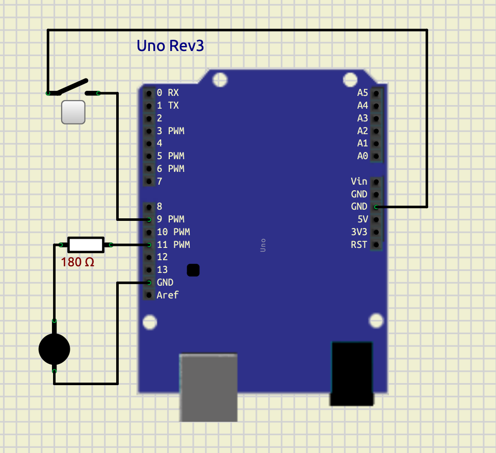

# arduino-simple-blink

A switch-controlled blinking LED on an Arduino Uno R3, written in bare-metal C23: no Arduino IDE
and no Arduino libraries. It's a small learning project that runs both on a real board and in
[SimulIDE](https://simulide.com/).

While the switch is on, the LED blinks every 250 ms. Each time the switch changes, the board says
so over serial (`Starting blink!` / `Stopping blink!`), which you can watch in the browser with
`task monitor`. The switch is debounced: a change only counts once the pin has been steady for
20 ms.

## How it works

| Part | How |
| --- | --- |
| Pins | `helpers/pins` maps board labels (D0–D13, A0–A5) to the DDRx / PORTx / PINx registers |
| Time | Hardware Timer0 interrupts once per millisecond (16 MHz ÷ 64 ÷ 250) and counts up; `time_now()` reads the count atomically. The count is 64-bit, so it never wraps |
| Main loop | Reads the time once per pass and hands it to everything: due callbacks, then buttons, then lights |
| Blink | `lights.c` is a chain of timed callbacks: each toggle flips the LED and schedules the next one 250 ms after the last deadline, so the rhythm doesn't drift. Stopping cancels the pending toggle |
| Buttons | `input_switch` debounces a switch on any pin: a pin-change interrupt counts every change in its level (ignoring other pins that share the interrupt), and each change cancels the pending 20 ms timer and starts a fresh one, so the switch only changes state after 20 ms without changes. `buttons.c` keeps a table of them, one per `button_id_t`; the light switch on D9 is the only one so far |
| Timed callbacks | `callbacks_time` runs a function once at a set time, handing it a context pointer given when it was scheduled (so one function can serve many LEDs or buttons). One shared queue: a handle pool hands out slots, and a heap keeps them in deadline order |
| Handles | `handle_pool` gives each callback a handle that goes stale once the callback runs or is cancelled, so an old handle can never cancel a newer callback that reused its slot |
| Serial | `serial_write_string()` queues text in a 128-byte ring buffer and returns at once; the "data register empty" interrupt sends it a byte at a time at 9600 baud |
| Ring buffer | When full, it overwrites the oldest unsent bytes. It's plain C, so it's unit tested on the Mac |

Values shared between the main loop and an interrupt are `volatile`, so every read really
reads memory. Multi-byte ones (the clock, the serial queue) are also read or written inside
`ATOMIC_BLOCK` in the main loop, so an interrupt can never see, or cause, a half-finished update.
Single bytes, like the switch's edge count, can't be half-written, so `volatile` is enough.

## Circuit

<a href="simulide-screenshot.png">
  
</a>

*Click the image to see it full size.*

- **LED polarity:** the screenshot doesn't mark it. The anode (+) connects to the resistor and the
  cathode (−) to GND.
- **Resistor:** for an LED with a 2.4 V forward voltage, 180 Ω gives about
  `(5 V − 2.4 V) / 180 Ω ≈ 14 mA`, comfortably under a 20 mA per-pin design limit. Recalculate
  for other LEDs.
- **Switch:** it needs no resistor of its own. The chip's internal pull-up holds D9 HIGH, and
  closing the switch pulls it LOW.

If you change pins, flash the new firmware *before* moving wires, and move them with the power
off. Old firmware could drive a pin HIGH that is now wired to GND.

## Requirements

The build has been tested on macOS (Apple silicon) with [Homebrew](https://brew.sh/):

```sh
brew tap osx-cross/avr
brew install avr-gcc@16 avrdude go-task watchexec
export PATH="$(brew --prefix avr-gcc@16)/bin:$PATH"  # avr-gcc@16 is keg-only
```

- `task test` and `task fmt` also need Xcode, for its bundled `clang` and `clang-format`.
- `task monitor` needs Python 3 (for a tiny local web server) and a Chromium-based browser:
  Chrome, Edge or Brave. Firefox and Safari don't support WebSerial.

## Usage

| Command           | What it does                                          |
| ----------------- | ----------------------------------------------------- |
| `task`            | List the available tasks                              |
| `task build`      | Compile to `build/release/simple-blink.hex`           |
| `task debug`      | Debug build in `build/debug/`                         |
| `task dev`        | Rebuild whenever a source file changes                |
| `task test`       | Run the unit tests in `test/` on your Mac             |
| `task test:watch` | Re-run the unit tests whenever a source file changes  |
| `task flash`      | Build and upload to an Uno over USB                   |
| `task monitor`    | Serial monitor in the browser (Chrome, Edge or Brave) |
| `task monitor:terminal` | Serial monitor in the terminal (quit: Ctrl-A, K, Y) |
| `task fmt`        | Format the C sources and tests                        |
| `task clean`      | Delete build output                                   |

Unit tests run on the Mac, not the chip, so they can only test code that doesn't touch the
hardware registers. Each `test/<name>_test.c` is a small program with its own `main()`, linked
with the `<name>.c` found anywhere under `src/`, plus every file in `src/helpers/` that doesn't
include `<avr/...>` or `<util/...>` (so `callbacks_time` can use `handle_pool` and `time_heap`).
The linker drops whatever a test doesn't use, so a helper that calls hardware code (like
`input_switch`, which calls `pins`) can sit in that list as long as no test uses it.
`task test` runs them all at the firmware's `CALLBACKS_TIME_CAPACITY`, then the callbacks tests
again at the library's maximum of 255.

### Configuration

| Where | What | Examples |
| --- | --- | --- |
| `src/config.h` | Choices for this app: which pins, how fast, how long | `PIN_LED`, `BLINK_SPEED`, `BUTTON_SWITCH_DEBOUNCE_THRESHOLD_MS` |
| `Taskfile.yml` | Settings that tools, system headers or `src/helpers/` also need, passed to the compiler as `-D...` | `F_CPU`, `BAUD_RATE`, `CALLBACKS_TIME_CAPACITY` |

`src/helpers/` never includes `config.h`, so it stays reusable in other projects. Taskfile
settings can be overridden per run, e.g. `task build CALLBACKS_TIME_CAPACITY=8`.

To add a button: give it a `BUTTON_ID_...` in `src/buttons.h`, an entry in the table at the top
of `src/buttons.c`, and, if it's not on D8–D13, an interrupt for its port (see the comment on
the ISR there). Read it anywhere with `button_is_pressed(BUTTON_ID_...)`. Each button pending
a change takes a `CALLBACKS_TIME_CAPACITY` slot, so raise that too if you add several.

### On a real board

```sh
task flash
```

This finds official Uno boards by their USB ID (macOS only). For a clone, or if several boards are
plugged in, name the port:

```sh
ls /dev/cu.*
task flash UNO_PORT=/dev/cu.xxx
```

### Watching serial output

```sh
task monitor
```

This serves `frontend/` at `http://127.0.0.1:8765` and opens it in Chrome (or Edge or Brave).
Press **Connect** and pick the board. Ctrl-C in the terminal stops the server.

- Only one program can use the port at a time: press **Disconnect** before `task flash`.
- Connecting resets the Uno, so its output starts again from the top.
- The first connect after flashing or plugging in may show a few old lines first. They were sent
  while nothing was listening and waited in the USB chip until the port opened.
- Characters that can't be printed show up highlighted (for example `\x00`), and invalid bytes as
  `�`. Lots of `�` usually means the baud rates don't match.

`task monitor:terminal` shows the same output in the terminal instead, using `screen`.

### In SimulIDE

Run `task build`, then open `circuit/simple-blink.sim2` in SimulIDE 2.0. The circuit loads the
release `.hex` by itself. To see serial output, right-click the Uno, open its serial monitor, and
restart the simulation.

## Layout

| Path | Contents |
| --- | --- |
| `src/main.c` | Sets everything up, then runs the main loop |
| `src/config.h` | App settings: pins and timings |
| `src/lights.*` | Non-blocking blink, driven by timed callbacks |
| `src/buttons.*` | The app's buttons: a table of `input_switch`es by `button_id_t`, and their interrupt |
| `src/helpers/pins.*` | Digital I/O over the DDRx / PORTx / PINx registers, and pin-change interrupts |
| `src/helpers/serial.*` | Interrupt-driven serial output |
| `src/helpers/ring_buffer.*` | Fixed-size byte queue used by serial |
| `src/helpers/time_utils.*` | Millisecond clock from Timer0 |
| `src/helpers/input_switch.*` | Debounced switch on any pin, with or without the internal pull-up |
| `src/helpers/callbacks_time.*` | One shared queue of timed callbacks |
| `src/helpers/handle_pool.*` | Handles that go stale when their slot is freed or reused |
| `src/helpers/time_heap.*` | Ids ordered by deadline, with removal and rescheduling |
| `src/helpers/math_utils.*` | Integer rounding division |
| `test/` | Unit tests that run on the Mac |
| `frontend/` | Browser serial monitor (WebSerial), served by `task monitor` |
| `scripts/find-uno-port.sh` | Finds the Uno's serial port, for `flash` and `monitor:terminal` |
| `circuit/simple-blink.sim2` | SimulIDE circuit |
| `simulide-screenshot.png` | Picture of the circuit |
| `Taskfile.yml` | Build, test, upload and monitor commands |
| `.clang-format`, `.zed/` | Code style and [Zed](https://zed.dev/) settings |

`.clangd` is generated by `task build` and `task test`, because it contains paths specific to your
machine. It tells the editor to read `src/` the way avr-gcc compiles it, and `test/` the way the
Mac's clang does.

## References

- [Uno R3 pinout](https://docs.arduino.cc/resources/pinouts/A000066-full-pinout.pdf)
- [ATmega328P datasheet](https://ww1.microchip.com/downloads/aemDocuments/documents/MCU08/ProductDocuments/DataSheets/ATmega48A-PA-88A-PA-168A-PA-328-P-DS-DS40002061B.pdf)
- [avr-libc manual](https://avrdudes.github.io/avr-libc/avr-libc-user-manual/)

## License

[MIT](LICENSE)
